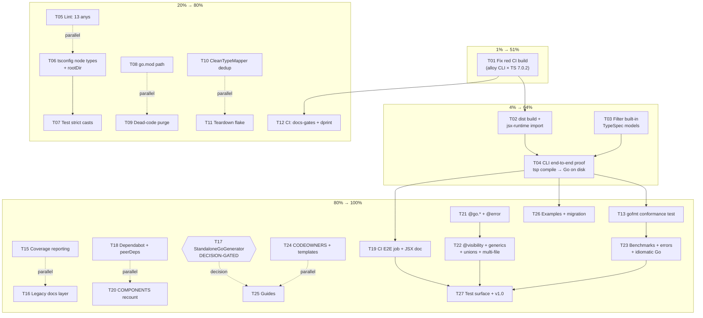

# SUPERB Pareto Execution Plan — 51% / 64% / 80% / 100%

**Created:** 2026-11-14 08:42 CET
**Scope:** ALL 50 open TODOs from the 2026-11-14 session status report
(`docs/status/2026-11-14_06-21_docs-health-corpus-sweep-and-living-docs-rebuild.md`),
which are exactly the items in `TODO_LIST.md` (bounded work) + `ROADMAP.md`
(raw ideas). Every item was verified open against the code THIS session.

**Repo baseline at plan time:** 165/165 tests (36 files) · local `alloy build`
green · CI RED (alloy CLI × TypeScript 7.0.2, `ts.sys` undefined, run
43432825741) · 13 lint errors · 28 strict-mode type errors · docs-gates 5/5
PASS · branch `lars/lets-rock`, HEAD `8205ea3`.

---

## 1. The Pareto breakdown

### 1% that delivers 51% of the result — 1 task, ~1h

**Fix the red CI build.** Every automated guarantee (lint, typecheck, E2E,
docs-gates, release) hangs off a green CI. While CI is red, nothing else can
be trusted or automated, and every push is unverified. One task, one
dependency decision (TS downgrade vs alloy-cli upgrade), unlocks the entire
rest of the plan. That is the 51%.

### 4% that delivers 64% of the result — 4 tasks, ~4h

**1% + prove the product actually works for a user.** Build `dist/`, fix the
built emitter (jsx-runtime import), filter built-in TypeSpec models, and run
one real `tsp compile` end-to-end producing Go files on disk. This converts
the project from "165 tests pass in vitro" to "the emitter does its job when
a user runs it" — the difference between a test suite and a product.

### 20% that delivers 80% of the result — 12 tasks, ~11h

**4% + credibility and hygiene.** Clear the lint and strict-mode debt, fix
the placeholder `go.mod`, delete dead files, deduplicate the type mapper,
kill the test flake, and enforce docs-gates + dprint in CI. After this the
repo is: green CI, working CLI, clean lint, honest typecheck, enforced docs
ritual, no dead weight. Credible and maintainable.

### The remaining 80% → 100% — everything else (15 tasks, ~19h + decision)

Coverage reporting, generated-output conformance tests, ghost-system
dispositions, legacy-doc archival, community plumbing, guides, and the
long-term feature surface (`@go.*` decorators, `@error`, `@visibility`,
generics, benchmarks, examples, migration guide, v1.0 release). High value,
but none of it blocks trust the way the tiers above do.

---

## 2. Comprehensive plan (30-100 min tasks — ALL 50 TODOs, execution order)

| # | Task | Min | TODOs | Impact | Customer value | Depends on |
|---|------|----:|-------|--------|----------------|------------|
| T01 | Fix red CI build: reproduce alloy CLI × TS 7.0.2 crash, pick fix (upgrade `@alloy-js/cli` or pin `typescript` 5.x), land green run | 60 | #1 | 🔴 Critical | 🔴 Critical | — |
| T02 | Build `dist/`, fix built-emitter import (`@alloy-js/core/jsx-runtime`, not jsx-dev-runtime) | 45 | #4a | 🔴 Critical | 🔴 Critical | T01 decision |
| T03 | Filter built-in TypeSpec-namespace models in `collectTypesByNamespace` + unit test | 60 | #5 | 🔴 Critical | 🔴 Critical | — |
| T04 | CLI end-to-end proof: `tsp compile examples/basic` → Go files on disk → content-verify; add `npm run test:e2e-cli` | 90 | #4b, #30 | 🔴 Critical | 🔴 Critical | T02, T03 |
| T05 | Clear 13 `no-explicit-any` lint errors + 1 unused-var in test-support files | 45 | #2 | 🟠 High | 🟡 Med | T01 |
| T06 | tsconfig hygiene: `types: ["node"]` for strict check + `rootDir` (kills TS5011 warning) | 90 | #3a, #21 | 🟠 High | 🟡 Med | — |
| T07 | Fix 16 test-file strict-mode errors (`unknown → Model` casts in 9 files) via mock-factory typing | 90 | #3b | 🟠 High | 🟡 Med | T06 |
| T08 | Fix `go.mod` placeholder module path | 30 | #10 | 🟡 Med | 🟢 Low | — |
| T09 | Dead-code purge: delete `GoHandlerStub.tsx.disabled`, `test-minimal/test-components/test-components-directly`, `src/test/temp-e2e-test/` | 60 | #9, #14, #15 | 🟡 Med | 🟢 Low | — |
| T10 | Deduplicate type mapping into `CleanTypeMapper` (`GoStructDeclaration.tsx:130` + enum/union audit) | 60 | #6 | 🟠 High | 🟡 Med | — |
| T11 | Fix intermittent `EnvironmentTeardownError` flake in `components-basic.test.tsx` | 45 | #11 | 🟡 Med | 🟡 Med | — |
| T12 | CI quality batch: docs-gates job + dprint format check + `.config/metadata.yaml` dprint exclusion | 75 | #23, #24, #22 | 🟠 High | 🟡 Med | T01 |
| T13 | Generated-Go conformance test: gofmt/goimports check over emitted output (grounds the README claim) | 60 | #29 | 🟠 High | 🟠 High | T04 |
| T14 | Verify README `tspconfig.yaml` emitter-options example parses (`base-package` etc.) | 30 | #30 | 🟡 Med | 🟡 Med | T04 |
| T15 | Coverage reporting: vitest coverage config + threshold + npm script | 45 | #8 | 🟡 Med | 🟡 Med | T01 |
| T16 | Legacy docs layer: annotate/archive 7 root reports + resolve `docs/status.md` naming + normalize `archived-2025-12-04/` + consolidate CALL_GRAPH pair + retire `justfile` from docs | 100 | #12, #16, #17, #18, #19, #20 | 🟡 Med | 🟢 Low | — |
| T17 | ⚠ DECISION-GATED: StandaloneGoGenerator disposition (wire into emitter path OR fence as documented test scaffold) | 45 | #13 | 🟡 Med | 🟡 Med | user decision |
| T18 | Dependabot branch pickup + reconcile `@typespec/compiler` dep/peerDep versioning | 30 | #26, #27 | 🟢 Low | 🟢 Low | — |
| T19 | CI E2E job (real .tsp through built emitter) + document vitest `jsx:"preserve"` as single JSX-config source of truth | 60 | #25, #28 | 🟠 High | 🟡 Med | T01, T04 |
| T20 | Recount COMPONENTS.md claims (12+5) against `src/components/go/` | 30 | #31 | 🟢 Low | 🟡 Med | — |
| T21 | Feature batch A: `@go.name`/`@go.type`/`@go.tag`/`@go.package` decorators + `@error` model handling | 90 | #33, #34 | 🟠 High | 🟠 High | T10 |
| T22 | Feature batch B: `@visibility` processing + generics end-to-end + discriminated unions + multi-file splitting | 100 | #35, #36, #37, #38 | 🟠 High | 🟠 High | T21 |
| T23 | Quality batch: benchmark suite scaffold + TypeSpec validation error clarity + idiomatic-Go pass | 75 | #39, #41, #42 | 🟡 Med | 🟡 Med | T13 |
| T24 | Community plumbing: `.github/CODEOWNERS` + `.github/ISSUE_TEMPLATE` | 30 | #43, #44 | 🟢 Low | 🟡 Med | — |
| T25 | Guides: `docs/ARCHITECTURE.md` + deployment + troubleshooting | 75 | #45, #46 | 🟡 Med | 🟡 Med | T17 |
| T26 | Examples expansion beyond `examples/basic/` + TypeSpec→Go migration guide | 75 | #47, #48 | 🟡 Med | 🟠 High | T04 |
| T27 | Test-surface expansion (visibility/templates/cross-file/HTTP-metadata) + v1.0 release flow (tag + npm publish) | 90 | #49, #50 | 🟠 High | 🟠 High | T19, T21-T23 |

Totals: 27 tasks ≈ 31h. 1% = T01. 4% = T01-T04. 20% = T01-T12. 100% = T01-T27.

---

## 3. Micro plan (each ≤ 12 min — ALL 50 TODOs, execution order)

### Tier 1% → T01 Fix red CI build (#1)

| ID | Micro task | Min |
|----|-----------|----:|
| M01 | Read `node_modules/@alloy-js/cli/dist/cli.js:17` crash site; note exactly which `ts.sys` API it needs | 5 |
| M02 | Check `@alloy-js/cli` npm releases for a TS7-compatible version (changelog/peer ranges) | 10 |
| M03 | Branch `fix/ci-alloy-ts7`: try upgrade path first — bump `@alloy-js/cli` in package.json, `bun install` | 10 |
| M04 | Local build + test run on the upgrade branch; record result | 10 |
| M05 | If upgrade fails: pin `typescript` to latest 5.x; `bun install`; local build + tests | 10 |
| M06 | Reproduce CI green locally-equivalent: run build, `test:typespec`, lint, `build:check` in sequence | 10 |
| M07 | Push branch, watch CI run to green (or capture new failure) | 5 |
| M08 | Land fix on `lars/lets-rock`; update TODO_LIST row + CHANGELOG entry | 10 |

### Tier 4% → T02-T04 Product proof (#4, #5, #30)

| ID | Micro task | Min |
|----|-----------|----:|
| M09 | `./node_modules/.bin/alloy build`; inspect `dist/` for `jsx-dev-runtime` imports | 10 |
| M10 | Fix the dist import at its source (build config or import rewrite); rebuild + grep clean | 10 |
| M11 | Read `collectTypesByNamespace` in `src/emitter/typespec-go-emitter.tsx`; write failing unit test for TypeSpec-namespace leakage | 10 |
| M12 | Implement the namespace filter; make the test pass | 10 |
| M13 | Add second test: user-namespace models survive filtering | 10 |
| M14 | Run `tsp compile examples/basic/main.tsp --emit @typespec-community/typespec-go` locally; capture errors | 10 |
| M15 | Fix whatever blocks CLI execution (paths, decorators `@pkg`/`$pkg`, emitter registration) | 12 |
| M16 | Get Go files written to disk; inspect output vs FEATURES example | 10 |
| M17 | Add `npm run test:e2e-cli` script wrapping the compile+assert flow | 10 |
| M18 | Verify README `tspconfig.yaml` options (`base-package`) parse; correct README if not (TODO #30) | 10 |

### Tier 20% → T05-T12 Credibility & hygiene (#2, #3, #6, #9-#11, #14, #15, #22-#24)

| ID | Micro task | Min |
|----|-----------|----:|
| M19 | Fix `src/test/enum-union-integration.test.tsx` — 10 `no-explicit-any` errors (mock typing) | 12 |
| M20 | Fix `src/test/doc-decorator-support.test.tsx:85,109` | 10 |
| M21 | Fix `src/testing/go-component-test-utils.tsx:54` any + :36 unused arg | 10 |
| M22 | `npm run lint` green; commit | 5 |
| M23 | tsconfig: add `"types": ["node"]`; rerun strict check; count remaining errors | 10 |
| M24 | Fix `structured-logging.ts` / emitter node-type fallout | 10 |
| M25 | Fix `unknown → Model` casts batch 1: extended-scalars.test.tsx (5) | 12 |
| M26 | Fix casts batch 2: pointer-types, struct-isolated, route-registration (6) | 12 |
| M27 | Fix casts batch 3: doc-decorator + go-formatter + leftovers | 10 |
| M28 | `npm run build:check` green (TODO #3 closed) | 5 |
| M29 | Set `rootDir: "./src"` in tsconfig; verify TS5011 warning gone (TODO #21 closed) | 5 |
| M30 | Fix `go.mod` module path to a real module path; `go build ./...` sanity if Go present (TODO #10) | 10 |
| M31 | `git rm` GoHandlerStub.tsx.disabled; verify no references (TODO #9) | 5 |
| M32 | Delete `test-minimal.tsx`, `test-components.tsx`, `test-components-directly.tsx`; re-run tests + strict check (TODO #14) | 10 |
| M33 | Remove `src/test/temp-e2e-test/` (TODO #15) | 5 |
| M34 | Audit `mapTypeSpecToGoType` in GoStructDeclaration + enum/union duplicates; list all mapping call sites | 10 |
| M35 | Route duplicate call sites through CleanTypeMapper; keep tests green (TODO #6) | 12 |
| M36 | Reproduce teardown flake: run components-basic.test.tsx 10× loop; confirm rate | 10 |
| M37 | Fix flake (hoist jsx-runtime import / adjust vitest pool+isolate); 10× loop clean (TODO #11) | 12 |
| M38 | Add docs-gates CI job (`nix run github:Artmann-Technologies/docs-gates -- run .`) (TODO #23) | 12 |
| M39 | Add dprint `--check` step to CI (TODO #24) | 5 |
| M40 | Add `.config/**` to dprint excludes; verify `dprint fmt` leaves tree clean (TODO #22) | 5 |

### 80→100% → T13-T20 Verification, coverage, legacy (TODO #8, #12, #16-#20, #26, #27, #29, #31)

| ID | Micro task | Min |
|----|-----------|----:|
| M41 | Write conformance test: assert generated Go parses/`gofmt -l` clean (invoke go fmt check or bracket/indent guard) (TODO #29) | 12 |
| M42 | Wire conformance test into the e2e flow; re-claim gofmt claim in README | 10 |
| M43 | vitest coverage config (`--coverage.enabled`, v8 provider) + npm script (TODO #8) | 10 |
| M44 | Set coverage threshold; tune to honest floor; document | 10 |
| M45 | Diff CALL_GRAPH.md vs CALL_GRAPH_ACTUAL.md; merge into one truthful file (TODO #12) | 12 |
| M46 | Root-report triage: classify 7 root .md files (annotate vs archive vs delete) (TODO #16) | 12 |
| M47 | Execute triage part 1 (archive batch) | 12 |
| M48 | Execute triage part 2 (annotate rest); resolve `docs/status.md` naming (TODO #17) | 12 |
| M49 | Run check-rows/bare-rows over `archived-2025-12-04/`; fix or ledger-exempt stragglers (TODO #19) | 12 |
| M50 | Remove `just` references from README/AGENTS; point at npm scripts; mark justfile deprecated (TODO #20) | 10 |
| M51 | Review `docs/github-issues-plan.md` staleness; annotate or archive (TODO #18) | 10 |
| M52 | Fetch dependabot branch, rebase, CI, merge or close (TODO #26) | 12 |
| M53 | Reconcile `@typespec/compiler` ^1.18.0 vs peer 1.18.0; align package.json (TODO #27) | 10 |
| M54 | StandaloneGoGenerator disposition (DECISION-GATED): read its API surface + test usage; write 1-page integration-vs-fence memo (TODO #13) | 12 |
| M55 | (post-decision) execute: wire into emitter path OR quarantine + FEATURES note | 12 |

### Feature surface → T20-T27 (TODO #31-#50)

| ID | Micro task | Min |
|----|-----------|----:|
| M56 | Recount COMPONENTS.md (12+5) against `src/components/go/`; correct drift (TODO #31) | 10 |
| M57 | CI E2E job: new workflow step running `test:e2e-cli` (TODO #25) | 12 |
| M58 | JSX-config source-of-truth note in SETUP.md (tsconfig vs vitest.config vs alloy) (TODO #28) | 10 |
| M59 | `@go.name`/`@go.type` decorator processing + tests (TODO #33) | 12 |
| M60 | `@go.tag`/`@go.package` decorator processing + tests (TODO #33) | 12 |
| M61 | `@error` model handling + tests (TODO #34) | 12 |
| M62 | `@visibility` processing spike + tests (TODO #35) | 12 |
| M63 | Generics: template params → Go type params, e2e (TODO #36) | 12 |
| M64 | Discriminated-union error chains (TODO #37) | 12 |
| M65 | Multi-file output splitting (per-type files) + tests (TODO #38) | 12 |
| M66 | Benchmark scaffold: vitest bench for model/enum/union generation (TODO #39) | 12 |
| M67 | Validation error clarity: map compiler diagnostics to actionable messages (TODO #41) | 12 |
| M68 | Idiomatic-Go pass on generator output naming (TODO #42) | 12 |
| M69 | `.github/CODEOWNERS` (TODO #43) | 5 |
| M70 | `.github/ISSUE_TEMPLATE` (bug + feature templates) (TODO #44) | 10 |
| M71 | `docs/ARCHITECTURE.md`: domain layer, component hierarchy, emitter pipeline (TODO #45) | 12 |
| M72 | Deployment guide (TODO #46) | 12 |
| M73 | Troubleshooting guide (TODO #46) | 12 |
| M74 | Migration guide: TypeSpec → Go mapping cookbook (TODO #47) | 12 |
| M75 | Real-world example project #2 (CRUD service) (TODO #48) | 12 |
| M76 | Test-surface: visibility-system tests (TODO #49) | 12 |
| M77 | Test-surface: template-type tests (TODO #49) | 12 |
| M78 | Test-surface: cross-file reference tests (TODO #49) | 12 |
| M79 | Test-surface: HTTP metadata extraction tests (TODO #49) | 12 |
| M80 | v1.0: version bump, CHANGELOG cut, tag, npm publish dry-run (TODO #50) | 12 |
| M81 | v1.0: publish + verify pkg on npm (TODO #50) | 10 |

Micro totals: 81 micro-tasks ≈ 13h focus time (excludes CI wait + decision wait). ALL 50 TODOs covered: #1→M01-M08, #2→M19-M22, #3→M23-M28, #4→M09-M17, #5→M11-M13, #6→M34-M35, #8→M43-M44, #9→M31, #10→M30, #11→M36-M37, #12→M45, #13→M54-M55, #14→M32, #15→M33, #16→M46-M48, #17→M48, #18→M51, #19→M49, #20→M50, #21→M29, #22→M40, #23→M38, #24→M39, #25→M57, #26→M52, #27→M53, #28→M58, #29→M41-M42, #30→M18, #31→M56, #33→M59-M60, #34→M61, #35→M62, #36→M63, #37→M64, #38→M65, #39→M66, #41→M67, #42→M68, #43→M69, #44→M70, #45→M71, #46→M72-M73, #47→M74, #48→M75, #49→M76-M79, #50→M80-M81. (TODO #32 does not exist — the numbering skips it by design in the source report.)

---

## 4. Execution graph

Read it as: T01 first (everything automated depends on it), then the 4%
chain T02→T03→T04 (product proof), then the 20% hygiene set in parallel,
then the long tail. Dashed edges are parallelizable; T17 waits on a human
decision.

---

## 5. Risks & anti-Verschlimmbesserung guardrails

1. **T01 changes dependency versions.** Default posture: prefer upgrading
   `@alloy-js/cli`; only pin TS 5.x if no compatible CLI exists — and if we
   pin, record WHY in CHANGELOG so a future TS7 re-upgrade is intentional,
   not accidental drift.
2. **Every task ends with the same gates:** `npm test -- --run`,
   `npm run lint`, `npm run build:check` (once green), and for docs work
   `docs-gates run .`. No task may leave any of them redder than it found
   them.
3. **T16/T17 touch history and architecture** — both are annotate/archive
   (non-destructive) or explicitly decision-gated. No rewrites of historical
   content; `git mv` only after gates pass.
4. **The justfile retirement (M50) only edits docs** — the justfile itself
   stays until the user confirms deletion (global policy: migrate, never
   break someone's muscle memory silently).
5. **v1.0 (M80-M81) ships only after TIER-20% gates are green and the
   conformance test (T13) exists** — a release from a red-CI repo would be
   the exact Verschlimmbesserung this plan exists to avoid.

---

## 6. Errata (Step 0 corrections)

- All 50 items re-verified open THIS session (2026-11-13/14) against code and
  CI — nothing here re-dispatches shipped work.
- The ~20 plans in `docs/planning/` dated 2025-11/12 are superseded
  snapshots of the architecture-crisis arc; their micro-tasks were either
  completed (see `CHANGELOG.md`) or folded into this plan. Do not mine them.
- TODO numbering #32 does not exist in the source report (numbering skips
  it); preserved here to keep the mapping auditable.
- `.config/metadata.yaml` dprint churn was restored but NOT excluded in the
  2026-11-13 session — M40 closes that gap.

---

**Plan generated:** 2026-11-14 08:42 CET · next review point: after T01 lands
(green CI) or 2026-11-21, whichever is first.
