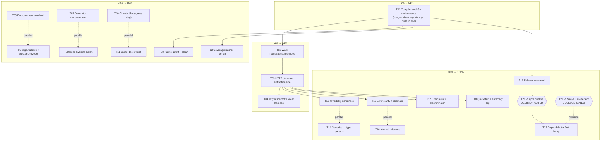

# SUPERB Pareto Execution Plan II — Compilable Go, HTTP Product, v1.0 Release

**Created:** 2026-11-14 18:45 CET
**Scope:** ALL remaining open work after the first SUPERB plan executed
(2026-11-14: CI green, CLI e2e, decorators, dedup, coverage, guides, legacy
archive, v1.0.0 prepared — 10 commits, `5df68e1`..`6f5bfb1`). Sources: the
status report `docs/status/2026-11-14_18-32_pareto-execution-and-v1.0-prep.md`
(§f list of 50), the refreshed `TODO_LIST.md` (10 open rows), and the three
unanswered owner questions.

**Repo baseline at plan time:** CI green end-to-end (run 43614800569) ·
177/177 tests · lint 0/0 · strict 0 · dprint clean · docs-gates 5/5 ·
`test:e2e-cli` green on both examples · v1.0.0 version-bumped but NOT
published · **generated Go is parse-clean but NOT proven compilable**
(the CRUD example's `unions.go` would fail `go build`: unused
`import "encoding/json"`).

---

## 1. The Pareto breakdown

### 1% that delivers 51% of the result — 1 task, ~90 min

**Compile-level Go conformance.** The e2e net currently proves generated Go
PARSES and gofmt-normalizes — nothing proves it COMPILES. One counterexample
already exists (unused import in `unions.go`). Fix import emission to be
usage-driven, implement-or-drop the placeholder unmarshaler, and add
`go build` in a module sandbox to the e2e net. Once merged, every future
change is machine-verified to produce compilable Go — that is the product's
trust anchor, the same role green CI played in plan I.

### 4% that delivers 64% of the result — 4 tasks, ~5 h

**1% + the HTTP product chain.** Today the emitter generates TYPES only.
Real TypeSpec APIs are interfaces with `@route`/`@get`/`@post` — and the
collector never even walks `namespace.interfaces` (flagship example:
`totalOperations: 0`). Walk interfaces, extract HTTP metadata, generate
handler methods + route registration for real specs, and pin it all with
`@typespec/http` inside the vitest harness. That converts the emitter from
"type generator" to "API skeleton generator" — the difference between a
demo and the product the README promises.

### 20% that delivers 80% of the result — 12 tasks, ~11 h

**4% + correctness, polish, hygiene.** Doc-comment overhaul (package-level
docs, `// //` slash bug), consume the two declared-but-dead decorators
(`@go.nullable`, `@go.enumMode`), complete decorator target coverage,
native `gofmt -l`-clean output, repo hygiene (preflight artifact, lockfile
duel, strays), CI truth (verify the masked docs-gates step, cache it, drop
the legacy prettier step), living-doc refresh that was skipped last time
(FEATURES body, ROADMAP, CONTRIBUTING, SETUP, API-REFERENCE), and coverage
ratchet documentation. After this: every claim in README/FEATURES is
machine-verified or removed.

### The remaining 80% → 100% — everything else (~14 h + 3 decisions)

Visibility semantics, generics → type parameters, error clarity +
idiomatic pass, internal refactors, example #3, consumer quickstart,
release rehearsal, and the three decision-gated items (npm publish,
StandaloneGoGenerator disposition, root-layer strays).

---

## 2. Comprehensive plan (30–100 min tasks — ALL remaining TODOs, execution order)

| #   | Task                                                                                                                                                                                                                      | Min | Source TODOs                                | Impact      | Customer value | Depends on |
| --- | ------------------------------------------------------------------------------------------------------------------------------------------------------------------------------------------------------------------------- | --: | ------------------------------------------- | ----------- | -------------- | ---------- |
| T01 | Compile-level conformance: usage-driven import emission, resolve placeholder unmarshaler (implement minimal real one OR drop it), `go build` module-sandbox step in `test-e2e-cli`                                        |  90 | TODO_LIST M1, L2; report f4, f24            | 🔴 Critical | 🔴 Critical    | —          |
| T02 | Walk `namespace.interfaces` in `collectTypesByNamespace` (operations reach groups) + collector unit test + fix the false TODO_LIST evidence line                                                                          |  60 | TODO_LIST H1 prereq; report f1              | 🔴 Critical | 🔴 Critical    | —          |
| T03 | HTTP decorator extraction e2e: `@route`/`@get`/`@post`/`@path`/`@body` → handler methods + route registration in generated output; extend `examples/basic` assertions                                                     |  90 | TODO_LIST H1                                | 🔴 Critical | 🔴 Critical    | T01, T02   |
| T04 | `@typespec/http` in the vitest harness (`libraries` param) + HTTP integration test                                                                                                                                        |  60 | TODO_LIST M3                                | 🟠 High     | 🟠 High        | T03        |
| T05 | Doc-comment overhaul: one package-level doc block (not per type), fix `// //` slash bug, honor `@doc` on enums/unions                                                                                                     |  60 | TODO_LIST M2, L1; report f5, f6, f42        | 🟠 High     | 🟠 High        | —          |
| T06 | Consume `@go.nullable` (pointer vs zero value) and `@go.enumMode` (iota/string/name) + tests                                                                                                                              |  90 | TODO_LIST H2; report f7, f8                 | 🟠 High     | 🟠 High        | —          |
| T07 | Decorator completeness: `@go.name` for types/enums/operations; `@go.structTag` Record-form (Map) handling; align JS impl signatures with tsp declarations                                                                 |  90 | report f9, f17, f18                         | 🟠 High     | 🟠 High        | —          |
| T08 | Native `gofmt -l`-clean output: alignment + blank-line emission; drop the normalize step from e2e once green                                                                                                              |  90 | TODO_LIST M4; report f25                    | 🟠 High     | 🟡 Med         | —          |
| T09 | Repo hygiene: remove + gitignore `.docs-gates-preflight.json`, resolve `.go.mod.lock`, delete `working-emitter-demo.ts`, delete-or-implement `build:webpack` (⚠ root-stray deletions beyond these are T21 decision-gated) |  45 | TODO_LIST L3, L4; report f12, f20, f21, f22 | 🟡 Med      | 🟢 Low         | —          |
| T10 | CI truth: verify the docs-gates step actually succeeds (repo visibility first), cache or vendor the install, drop the legacy prettier `format --check` step                                                               |  45 | TODO_LIST L5; report f10, f32, f33          | 🟠 High     | 🟡 Med         | —          |
| T11 | Living-doc refresh: FEATURES inventory rows for all 2026-11-14 features, ROADMAP routed items, CONTRIBUTING/SETUP audit vs npm scripts, SETUP JSX-config note, API-REFERENCE rebuild                                      |  90 | report f11, f13, f14, f40                   | 🟠 High     | 🟡 Med         | —          |
| T12 | Coverage ratchet + thresholds documented; CLI e2e wall-clock benchmark                                                                                                                                                    |  45 | report f34, f41                             | 🟡 Med      | 🟡 Med         | T01        |
| T13 | `@visibility` semantics: design note (read/create/update model) → implement property filtering → tests                                                                                                                    | 100 | TODO_LIST H3; report f15                    | 🟠 High     | 🟠 High        | —          |
| T14 | Generics: template params → Go type parameters, e2e fixture with `Box<T>` style specs                                                                                                                                     | 100 | report f16                                  | 🟠 High     | 🟠 High        | —          |
| T15 | Error clarity + idiomatic pass: emitter failures name the failing namespace/type; receiver naming; import grouping (`goimports` style)                                                                                    |  90 | report f38, f39, f45                        | 🟡 Med      | 🟡 Med         | T03        |
| T16 | Internal refactors: extract GoPackageDirectory file-layout builder, unify `getOutputDirectory`/`namespaceToPackageName`, MockFactory → module functions, `clean-type-mapper` cast reduction, filename-case decisions      |  90 | report f26, f27, f35, f36, f37, f49         | 🟡 Med      | 🟢 Low         | —          |
| T17 | Example #3: versioned multi-namespace API + discriminated-union fixture (exercises GetType path in CI)                                                                                                                    |  75 | report f31, f44                             | 🟡 Med      | 🟠 High        | T03        |
| T18 | Consumer quickstart doc (copies crud example verbatim) + emitter generation-summary log (what was written where)                                                                                                          |  60 | report f43, f48                             | 🟡 Med      | 🟠 High        | T03        |
| T19 | Release rehearsal: SECURITY.md check against release process, local `v1.0.0-rc.1` tag (not pushed), `npm pack` + install-from-tarball smoke test                                                                          |  45 | report f46, f47                             | 🟠 High     | 🟠 High        | T01–T12    |
| T20 | ⚠ DECISION-GATED: `npm publish` + push `v1.0.0` tag (owner question 1)                                                                                                                                                    |  15 | TODO_LIST Done §g                           | 🔴 Critical | 🔴 Critical    | T19, owner |
| T21 | ⚠ DECISION-GATED: root strays (`pnpm-lock.yaml`) + StandaloneGoGenerator disposition confirm (owner questions 2+3)                                                                                                        |  30 | report g2, g3                               | 🟡 Med      | 🟢 Low         | owner      |
| T22 | Post-release: dependabot recreation verification + first dependency bump through the full-gate pipeline                                                                                                                   |  45 | report f50                                  | 🟢 Low      | 🟡 Med         | T20        |

Totals: 22 tasks ≈ 29 h owner-work + 3 decision gates. 1% = T01. 4% =
T01–T04. 20% = T01–T12. 100% = T01–T22.

---

## 3. Micro plan (each ≤ 12 min — ALL remaining TODOs, execution order)

### Tier 1% → T01 Compile-level conformance

| ID  | Micro task                                                                                                              | Min |
| --- | ----------------------------------------------------------------------------------------------------------------------- | --: |
| M01 | Reproduce: `go build` the CRUD example output in /tmp sandbox; capture the unused-import error verbatim                 |  10 |
| M02 | Read GoPackageDirectory import emission (`needsFmt`/`SingleImportStatement`); list every emitted import vs actual usage |  10 |
| M03 | Make unions.go imports usage-driven (emit `encoding/json` only when the unmarshaler is real)                            |  12 |
| M04 | Decide + implement minimal real `UnmarshalX` via `encoding/json` OR remove the placeholder function entirely            |  12 |
| M05 | Add `go-build-conformance` to `test-e2e-cli`: create /tmp module, copy generated files, `go build ./...`                |  12 |
| M06 | Run e2e until build-conformance green on BOTH examples; record output in the run summary                                |  10 |

### Tier 4% → T02–T04 HTTP product chain

| ID  | Micro task                                                                                                                      | Min |
| --- | ------------------------------------------------------------------------------------------------------------------------------- | --: |
| M07 | Add failing collector test: interface operations must reach the namespace group                                                 |  10 |
| M08 | Implement `namespace.interfaces` walk in `collectTypesByNamespace` (flatten interface ops into `group.operations`)              |  12 |
| M09 | Fix the false TODO_LIST evidence line ("Interface operations are collected" → re-verify wording)                                |   5 |
| M10 | Inspect what GoHandlerStub/GoInterfaceDeclaration emit for the now-collected ops (likely breakage in models.go-free namespaces) |  10 |
| M11 | Extract `@route` path + verb via `@typespec/http` program access in the emitter/components                                      |  12 |
| M12 | Generate per-op handler methods with correct HTTP method + path in registration                                                 |  12 |
| M13 | Extend `test-e2e-cli` assertions: route lines + verbs present for `examples/basic` Widgets interface                            |  10 |
| M14 | `createTester(libraries: ["@typespec/http"])` harness spike; note version/peer requirements                                     |  12 |
| M15 | HTTP integration test: compile sample-service.tsp with HTTP lib, assert collector + generation                                  |  12 |
| M16 | Wire HTTP harness test into CI-visible suite; update TODO_LIST H1 row                                                           |  10 |

### Tier 20% → T05–T12 polish + hygiene

| ID  | Micro task                                                                                              | Min |
| --- | ------------------------------------------------------------------------------------------------------- | --: |
| M17 | Reproduce `// //` double-slash; locate `interfaceDoc` construction in GoUnionDeclaration                |   5 |
| M18 | Fix doc construction; same audit for GoEnumDeclaration + GoStructDeclaration default docs               |  10 |
| M19 | Hoist package doc to one SourceFile-level comment; strip per-type repetition                            |  12 |
| M20 | Honor `@doc` on enums/unions via getDocumentation (wiring exists, unverified)                           |  10 |
| M21 | Failing test: `@go.nullable(pointer)` → pointer; `(zeroValue)` → plain type                             |  12 |
| M22 | Implement nullable consumption in GoStructDeclaration (state lookup + pointer logic)                    |  12 |
| M23 | Failing test: `@go.enumMode(string)` → string constants on an int-valued enum                           |  12 |
| M24 | Implement enumMode consumption in GoEnumDeclaration                                                     |  12 |
| M25 | Extend consumption tests to cover both decorators in one e2e fixture                                    |  10 |
| M26 | `@go.name` on enum/union/model type declarations (TypeDeclaration name override)                        |  12 |
| M27 | `@go.structTag` Record-form: accept Map values, serialize to tag string, test                           |  12 |
| M28 | Align go-decorators.ts JS param types with `lib/main.tsp` declared targets                              |  10 |
| M29 | Diagnose gofmt -l deltas: dump gofmt diff for a generated file (alignment? blank lines?)                |  10 |
| M30 | Emit blank line between top-level declarations (separators audit in all 3 components)                   |  12 |
| M31 | Struct-member tag alignment: match gofmt column alignment or accept normalization — decide by diff size |  12 |
| M32 | Remove the gofmt `-w` normalize step from e2e once `-l` is clean; keep `-e` parse                       |   5 |
| M33 | `git rm --cached .docs-gates-preflight.json` + add to .gitignore                                        |   5 |
| M34 | `.go.mod.lock`: research purpose (0 bytes, git-tracked?), delete or document                            |  10 |
| M35 | Delete `working-emitter-demo.ts` after `grep -r` reference check                                        |   5 |
| M36 | `build:webpack`: verify webpack absent from deps → delete script + config if orphaned                   |  10 |
| M37 | CI: read the docs-gates step log from run 43614800569; record true result                               |  10 |
| M38 | Fix accordingly: cache go module path, vendor binary, or drop continue-on-error                         |  12 |
| M39 | Delete the legacy prettier `format --check` CI step (dprint owns formatting)                            |   5 |
| M40 | FEATURES.md: add rows for decorators, cross-file refs, conformance, coverage, benchmarks, guides        |  12 |
| M41 | ROADMAP.md: fold routed raw ideas from status report §f tail                                            |  10 |
| M42 | CONTRIBUTING.md + SETUP.md: audit commands vs package.json; fix drift                                   |  12 |
| M43 | SETUP.md: JSX-config source-of-truth note (tsconfig vs vitest.config vs alloy)                          |  10 |
| M44 | docs/API-REFERENCE.md: rebuild from current `dist` exports (or delete with routing note)                |  12 |
| M45 | Document coverage thresholds in CONTRIBUTING; ratchet 40/30/48/40 → +5 each                             |  10 |
| M46 | Add CLI e2e wall-clock bench to go-generation.bench.tsx                                                 |  12 |

### 80→100% → T13–T22 semantics, refactors, release

| ID  | Micro task                                                                                                  | Min |
| --- | ----------------------------------------------------------------------------------------------------------- | --: |
| M47 | `@visibility` design note: read/create/update model, what filters where                                     |  12 |
| M48 | Implement visibility read-filter for properties (skip create/update-only)                                   |  12 |
| M49 | Visibility tests: Read-only id visible; create-only field suppressed                                        |  12 |
| M50 | Generics design: template params → `[T any]` mapping rules; where type params attach                        |  12 |
| M51 | Generics fixture e2e: `Box<T>` model compiles + generates `type Box[T any] struct`                          |  12 |
| M52 | Generics edge: constraint handling (declare-only, follow-up)                                                |  10 |
| M53 | Emitter errors carry namespace + type context (error factory pass)                                          |  12 |
| M54 | Receiver naming audit (`e`, `s`) + goimports-style import grouping                                          |  12 |
| M55 | Extract file-layout builder from GoPackageDirectory (models/enums/unions/handlers blocks)                   |  12 |
| M56 | Unify `getOutputDirectory` + `namespaceToPackageName` into one mapper                                       |  10 |
| M57 | MockFactory class → module functions + call-site sweep                                                      |  12 |
| M58 | `clean-type-mapper.ts`: reduce `as unknown as` count by half; split classes                                 |  12 |
| M59 | Filename-case: kebab-case renames OR explicit oxlint overrides (decide by rename blast radius)              |  10 |
| M60 | Example #3 scaffold: versioned API, two namespaces, shared models                                           |  12 |
| M61 | Example #3 discriminated union + e2e assertions (GetType + unmarshal)                                       |  12 |
| M62 | Consumer quickstart doc: verbatim crud example, install → tspconfig → output                                |  12 |
| M63 | Emitter summary log: per-namespace file list at INFO level                                                  |  10 |
| M64 | SECURITY.md: verify against current release/deploy process                                                  |  10 |
| M65 | Local `v1.0.0-rc.1` annotated tag (NOT pushed); `npm pack`; install-from-tarball smoke test in /tmp project |  12 |
| M66 | Rehearsal findings folded into DEPLOYMENT.md                                                                |  10 |
| M67 | ⏸ AWAIT OWNER: `npm publish` + push `v1.0.0` tag (question 1)                                               |   5 |
| M68 | ⏸ AWAIT OWNER: root strays (`pnpm-lock.yaml`) deletion (question 3)                                         |  10 |
| M69 | ⏸ AWAIT OWNER: StandaloneGoGenerator keep-fenced vs delete (question 2)                                     |  10 |
| M70 | Execute owner dispositions from M68/M69                                                                     |  12 |
| M71 | Verify dependabot recreated the group bump; review against new gates                                        |  12 |
| M72 | First post-v1.0 dependency bump through full pipeline; CHANGELOG entry                                      |  12 |

Micro totals: 72 micro-tasks ≈ 12.5 h focus time (excludes CI waits and
owner-decision waits). Coverage mapping — TODO_LIST: H1→M07-M16, H2→M21-M25,
H3→M47-M49, M1→M03-M05, M2→M17-M19, M3→M14-M16, M4→M29-M32, L1→M17-M18,
L2→M03, L3→M33, L4→M34, L5→M37-M39; status-report §f: f1→M07-M09,
f4→M05, f5→M17, f6→M19, f7→M21-M22, f8→M23-M24, f9→M26, f10→M37-M38,
f11→M40, f12→M33, f13→M41-M42, f14→M43, f15→M47-M49, f16→M50-M52,
f17→M27, f18→M28, f20→M36, f21→M35, f22→M34, f24→M03, f25→M29-M32,
f26→M57, f27→M58, f31→M61, f32→M38, f33→M39, f34→M45, f35→M59, f36→M55,
f37→M56, f38→M53, f39→M54, f40→M44, f41→M46, f42→M20, f43→M63, f44→M60,
f45→M54, f46→M64, f47→M65-M66, f48→M62, f49→M58, f50→M71-M72,
f12→M33, f22→M34, g1→M67, g2→M69, g3→M68.

---

## 4. Execution graph

Read it as: T01 first (the trust anchor — nothing generated is proven
compilable until it lands), then the T02→T03→T04 product chain, then the
polish/hygiene set in parallel, then the long tail. Dashed edges are
parallelizable; T20/T21 wait on owner answers to the three questions from
the status report.

---

## 5. Risks & anti-Verschlimmbesserung guardrails

1. **T01 may cascade.** Fixing import emission can break the discriminated
   union path (fmt usage) — keep both examples green at every micro-step;
   the e2e net exists precisely to catch this.
2. **T02/T03 change the flagship example's output.** Generated files for
   `examples/basic` gain handler/route content — update e2e assertions in
   the same commit, never leave the net red overnight.
3. **Every task ends with the same gates:** `npm run test:typespec`,
   `npm run lint`, `npm run build:check`, `npm run format:check`,
   `npm run test:e2e-cli`, `docs-gates run .`. No task may leave any gate
   redder than it found them.
4. **History is annotate/archive only.** No rewrites of historical reports;
   `git mv` only after gates pass (T16 filename decisions follow the same
   rule).
5. **Publish stays gated.** T20 executes only on explicit owner instruction
   — same posture as plan I guardrail 5. A v1.0.0 from a repo whose
   generated output does not compile would be the exact Verschlimmbesserung
   this plan exists to prevent; T01 lands before T20 can even be rehearsed.
6. **Decorator consumption follows the tsp declarations,** not convenience:
   if `lib/main.tsp` says a target is `Enum`, the JS side reads enums — no
   silent widening.
7. **Refactors (T16) are behavior-preserving.** Each micro-step keeps the
   full gate set green; any red gate = revert the micro-step, not
   "fix forward".

---

## 6. Errata (Step 0 corrections)

- All items re-verified open THIS session against the code: interface
  operations confirmed NOT collected (`totalOperations: 0` in the basic
  example's emission log); `unions.go` unused import confirmed by
  `gofmt -e` output review; `.docs-gates-preflight.json` confirmed tracked
  in commit `6f5bfb1`.
- The previous plan's T13/T14 (conformance test, README options) shipped in
  slightly different form than planned — conformance landed at parse level,
  not compile level; this plan's T01 closes that gap honestly instead of
  re-claiming the old wording.
- TODO_LIST row "Interface operations are collected and handler files are
  generated" is FALSE as written (see status report §d1); M09 fixes the
  row's wording while T02 fixes the reality.
- Owner questions 1–3 (npm publish, StandaloneGoGenerator, root strays)
  were posed 2026-11-14 18:32 and remain unanswered — they are carried as
  decision gates M67–M69, NOT assumed.

---

**Plan generated:** 2026-11-14 18:45 CET · next review point: after T01
lands (compilable Go proven) or 2026-11-21, whichever is first.
