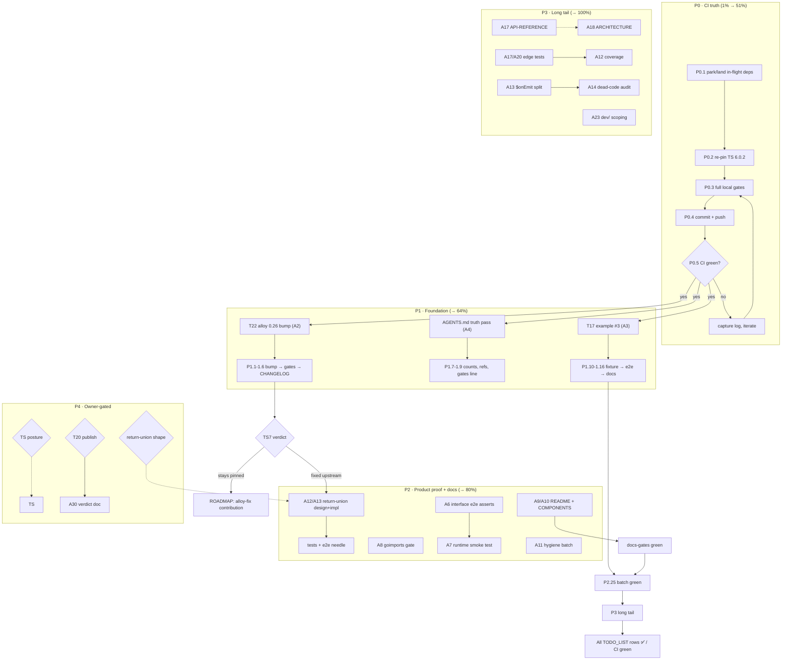

# Pareto Plan — CI Recovery First, Then Product Completion

**Date:** 2026-11-19 20:36 CET · **Branch:** `lars/lets-rock` · **HEAD:** `dcede26`
**Ground truth:** CI RED on HEAD since `45fa15e` (TS 7.0.2 × alloy CLI 0.22 crash, run 44059374575); local gates 206/206 green but on a stale TS 6.0.2 `node_modules` (not CI-predictive). TODO_LIST is the harvest source; both open status reports map into this plan. Companion status snapshot: [2026-11-19_20-36 status report](../status/2026-11-19_20-36_session-close-red-ci-flagged-plan-harvested.md).

**Guardrails (Verschlimmbesser-protection):** no refactor without a red test first; no dependency move without the full gate set (build → 206 tests → eslint 0/0 → strict 0 → dprint → e2e → docs-gates → CI green); no revert of foreign commits; one logical change per commit; every landed commit keeps CI green (P0 restores that invariant first).

## 1 · Pareto

| Slice                    | Content                                                                                                                                                                                                                                                                          | Why it carries the value                                                                                                                                                                                                     |
| ------------------------ | -------------------------------------------------------------------------------------------------------------------------------------------------------------------------------------------------------------------------------------------------------------------------------- | ---------------------------------------------------------------------------------------------------------------------------------------------------------------------------------------------------------------------------- |
| **1% → 51%**             | **P0: restore green CI** (re-pin TS 6.0.2, reconcile the parked dependency diff, verify a green run)                                                                                                                                                                             | Nothing is verifiable while the branch is red; every gate, every future commit and every release claim inherits this. ~35min total.                                                                                          |
| **4% → 64%**             | P0 **+ T22 (alloy 0.26 dependency bump through full gates) + T17 (example #3: versioned namespaces + discriminated unions) + AGENTS.md truth pass**                                                                                                                              | T22 answers the TS-7 future properly and un-blocks dependabot; T17 proves the two biggest remaining emitter features end-to-end (real customer value); AGENTS.md is every session's context — stale counts poison decisions. |
| **20% → 80%**            | P1 **+ generated-Go proof hardening (interface e2e asserts, `goimports -l` gate, runtime handler smoke test) + consumer docs (README options, COMPONENTS recount, MAPPING-GUIDE notes) + hygiene (minimatch override, PR #13 close, mock hardening) + return-union design+impl** | Turns "compiles" into "verified behavior", makes the repo consumable, and removes the biggest known correctness gap (`Widget                                                                                                 |
| **Remaining 20% → 100%** | P3 long tail (API-REFERENCE, ARCHITECTURE, SETUP audit, edge tests, dead-code audit, coverage, benchmarks, `$onEmit` split, logging, dev/ noise, root go.mod, ROADMAP refresh) **+ P4 owner-gated decisions** (T20 publish verdict, concurrency convention)                      | Completeness: everything else in TODO_LIST, each small and gated.                                                                                                                                                            |

## 2 · Table A — comprehensive plan (30–100 min tasks, sorted by impact/value/effort)

| #   | Task                                                                                                                                                                        | Covers                           | Effort              | Impact | Verify                        |
| --- | --------------------------------------------------------------------------------------------------------------------------------------------------------------------------- | -------------------------------- | ------------------- | ------ | ----------------------------- |
| A1  | **Restore green CI**: re-pin `typescript@6.0.2`, land-or-park the in-flight eslint/coverage diff, full gates, push, confirm green run                                       | d1 (red CI), TODO High row       | 40min               | **H**  | CI run green                  |
| A2  | **T22**: recreate dependabot group bump (alloy core/go/cli 0.26, emitter-framework 0.22) on current tree through full gates; record alloy-0.26×TS6/TS7 verdict in CHANGELOG | TODO row, 13:42 §f5              | 60min               | **H**  | gates + CI green, CHANGELOG   |
| A3  | **T17 example #3**: versioned multi-namespace API + discriminated-union fixture; e2e needles (`GetType`, `UnmarshalX`, versioned paths); `go build`+`gofmt` gates           | TODO row, 13:42 §f6              | 75min               | **H**  | e2e green on 3 examples       |
| A4  | **AGENTS.md truth pass**: fix 177/177 (3×), remove deleted-component refs (2×), refresh gates/HEAD                                                                          | TODO row, 16:55 item 10          | 30min               | **H**  | docs-gates, grep clean        |
| A5  | **Return-union semantics**: design (owner Q3) + implement `@error`-variant strip → `*Widget` in TypeExpression + tests                                                      | 13:42 §f7                        | 90min               | **H**  | unit + e2e needle             |
| A6  | **Interface e2e assertions**: interfaces.go must not contain `interface{}` for scalar path params                                                                           | 13:42 §f8                        | 30min               | M-H    | e2e gate                      |
| A7  | **Runtime handler smoke test**: mount RegisterRoutes in a Go test, GET + POST with body                                                                                     | 13:42 §f10                       | 60min               | M-H    | `go test` green in CI         |
| A8  | **`goimports -l` gate** in test-e2e-cli.mjs                                                                                                                                 | 13:42 §f9                        | 30min               | M      | e2e green                     |
| A9  | **README consumer docs**: `visibility-mode`, `go-module-path`, decorator table, `<Pkg>API` contract                                                                         | 13:42 §f17                       | 30min               | M-H    | docs-gates, links             |
| A10 | **COMPONENTS.md recount**                                                                                                                                                   | 13:42 §f18                       | 30min               | M      | count script/manual diff      |
| A11 | **Hygiene batch**: minimatch override; close stale PR #13; mock `importActual` hardening + `@go.pkg` error-context test; sorted-import e2e needle                           | TODO rows, 16:55 items 8/9/26/27 | 40min               | M      | gates green, PR closed        |
| A12 | **Coverage reporting**: vitest coverage + thresholds in CI                                                                                                                  | AGENTS sprint list               | 60min               | M      | coverage step green           |
| A13 | **`$onEmit` split**: option-parsing + per-namespace helpers (mechanical, behavior-identical)                                                                                | 16:55 item 30                    | 45min               | M-L    | 206/206 unchanged             |
| A14 | **Dead-code audit `src/domain/`**: struct-generator, union-generator, generator-utils, go-code-validation, error-* — live consumer or delete                                | TODO row, 16:55 item 18          | 30min               | M      | grep + build after deletes    |
| A15 | **API-REFERENCE rebuild** from current dist exports                                                                                                                         | 13:42 §f20                       | 60min               | M-L    | links resolve                 |
| A16 | **ARCHITECTURE.md**: interfaces walk + HTTP pipeline section                                                                                                                | 13:42 §f28                       | 30min               | M-L    | docs-gates                    |
| A17 | **Alignment edge tests + MergePatchUpdate guard** (empty/single-member structs, 0-member enum, name-collision guard)                                                        | 13:42 §f26/f27                   | 30min               | L-M    | new tests green               |
| A18 | **`@query` fixture + e2e assertion**                                                                                                                                        | 13:42 §f21                       | 20min               | L-M    | e2e green                     |
| A19 | **Route ordering**: stable alphabetical sort in RegisterRoutes                                                                                                              | 13:42 §f25                       | 15min               | L-M    | e2e needle                    |
| A20 | **`handler.returnType` into stub-body comments**                                                                                                                            | 13:42 §f24                       | 20min               | L      | snapshot diff                 |
| A21 | **`getHttpOperation` diagnostics surfaced** (no silent nulls)                                                                                                               | 13:42 §f23                       | 30min               | L-M    | warn-path test                |
| A22 | **console.warn → structured logging** in GoHandlerStub + test assert                                                                                                        | TODO row, 16:55 item 23          | 20min               | L      | test assert                   |
| A23 | **dev/ noise scoping**: eslint/oxlint ignore-or-fix for `dev/tests` parse errors + findings flood                                                                           | d5                               | 30min               | L      | BuildFlow warning count drops |
| A24 | **SETUP.md audit** vs package.json                                                                                                                                          | 13:42 §f19                       | 20min               | L      | doc-gates, manual diff        |
| A25 | **Root go.mod decision**: fix placeholder module path or document gotcha only                                                                                               | AGENTS gotcha                    | 15min               | L      | `go run` outside-repo note    |
| A26 | **ROADMAP refresh**: per-lifecycle visibility variants, benchmarks, generics constraints entries                                                                            | MAPPING-GUIDE/AGENTS pointers    | 20min               | L      | docs-gates                    |
| A27 | **CHANGELOG gates-count automation probe**                                                                                                                                  | 16:55 item 24                    | 15min               | L      | script or explicit won't-do   |
| A28 | **Daemon D-entry verification** (10 root-cleanup deletions reviewable)                                                                                                      | TODO row                         | 10min               | L      | git log evidence              |
| A29 | **Benchmark suite** (ROADMAP, generation perf)                                                                                                                              | AGENTS metrics gap               | 90min               | L      | bench script green            |
| A30 | **T20 npm publish** — owner-gated verdict doc (fold HTTP chain into v1.0.0 vs v1.1.0)                                                                                       | §g Q (09:26)                     | 15min post-decision | gated  | TODO flip                     |

## 3 · Table B — micro-tasks (≤12 min each, ALL items, execution order)

| ID    | Micro-task                                                                                                                                      | ≤min | Depends on    | Done-when                       |
| ----- | ----------------------------------------------------------------------------------------------------------------------------------------------- | ---- | ------------- | ------------------------------- |
| P0.1  | Read in-flight `package.json`/`bun.lock` diff; decide land-as-own-commit vs park (default: land eslint/coverage bumps separately through gates) | 12   | —             | decision recorded in commit msg |
| P0.2  | Re-pin `typescript` to `6.0.2` in package.json; `bun install`                                                                                   | 8    | P0.1          | lockfile diff only TS line      |
| P0.3  | Full local gates (build → tests → lint → strict → dprint → e2e → docs-gates)                                                                    | 12   | P0.2          | all green                       |
| P0.4  | Commit re-pin (detailed msg: restores d289c86 intent pending alloy fix) + push                                                                  | 5    | P0.3          | pushed                          |
| P0.5  | Watch CI run to green; if red, capture log and iterate once                                                                                     | 10   | P0.4          | green run recorded              |
| P1.1  | A2: read alloy 0.26 release notes for TS7 fix / breaking changes                                                                                | 10   | P0.5          | notes summarized                |
| P1.2  | A2: bump alloy core/go/cli/rollup-plugin + emitter-framework; `bun install`                                                                     | 12   | P1.1          | lockfile updated                |
| P1.3  | A2: `npm run build` + fix any component-type breakage                                                                                           | 12   | P1.2          | build green                     |
| P1.4  | A2: full test suite + strict                                                                                                                    | 10   | P1.3          | 206/206 + strict 0              |
| P1.5  | A2: e2e (3 examples after A3 lands; 2 before) + docs-gates                                                                                      | 10   | P1.4          | e2e green                       |
| P1.6  | A2: CHANGELOG dependency entry incl. TS-compat verdict; commit+push+CI                                                                          | 10   | P1.5          | CI green                        |
| P1.7  | A4: fix 3× stale test counts in AGENTS.md                                                                                                       | 9    | P0.5          | grep clean                      |
| P1.8  | A4: remove both `GoRouteRegistrationComponent.tsx` references                                                                                   | 8    | P1.7          | grep clean                      |
| P1.9  | A4: refresh AGENTS gates/HEAD lines + component tree listing                                                                                    | 12   | P1.8          | matches reality                 |
| P1.10 | A3: design example #3 fixture (ns `Acme.V1`+`Acme.V2`, `Pet` discriminated union)                                                               | 12   | P0.5          | sketch in file                  |
| P1.11 | A3: write `examples/versioned/main.tsp`                                                                                                         | 12   | P1.10         | tsp compiles                    |
| P1.12 | A3: wire third example into `scripts/test-e2e-cli.mjs`                                                                                          | 10   | P1.11         | script loops 3                  |
| P1.13 | A3: needles `GetType`, `UnmarshalV?Pet`, versioned package paths                                                                                | 12   | P1.12         | needles assert                  |
| P1.14 | A3: `go build ./...` + `gofmt -l` green on all three outputs                                                                                    | 10   | P1.13         | e2e green                       |
| P1.15 | A3: MAPPING-GUIDE §Namespaces example link + FEATURES row + CHANGELOG                                                                           | 10   | P1.14         | docs-gates green                |
| P1.16 | A3: commit+push+CI green                                                                                                                        | 8    | P1.15         | CI green                        |
| P2.1  | A11a: minimatch override in package.json `overrides`; pnpm-audit re-verify                                                                      | 10   | P0.5          | warning gone                    |
| P2.2  | A11b: close PR #13 with pointer comment to A2 commit                                                                                            | 8    | P1.6          | PR closed                       |
| P2.3  | A11c: harden `emitter-error-context.test.ts` (importActual spread)                                                                              | 10   | P0.5          | tests green                     |
| P2.4  | A11d: add `@go.pkg` invalid-value → namespace-context test                                                                                      | 10   | P2.3          | test green                      |
| P2.5  | A16: e2e needle for single sorted std import group in handlers.go                                                                               | 12   | P1.14         | needle asserts                  |
| P2.6  | A6a: extend e2e with interfaces.go content capture                                                                                              | 10   | P1.14         | capture works                   |
| P2.7  | A6b: assert no `interface{}` in interface signatures for scalar params                                                                          | 10   | P2.6          | assertion green                 |
| P2.8  | A8a: `goimports` availability check + raw-output run                                                                                            | 8    | P0.5          | know baseline                   |
| P2.9  | A8b: add `goimports -l` gate to e2e script + README dev note                                                                                    | 10   | P2.8          | gate green                      |
| P2.10 | A7a: Go test scaffold `examples/basic/handlers_test.go` (generated dir) or testdata copy strategy                                               | 12   | P2.6          | compiles                        |
| P2.11 | A7b: mount RegisterRoutes + httptest server                                                                                                     | 10   | P2.10         | server runs                     |
| P2.12 | A7c: GET assert (status + body)                                                                                                                 | 10   | P2.11         | test green                      |
| P2.13 | A7d: POST with body assert + wire `go test` into e2e                                                                                            | 12   | P2.12         | e2e green                       |
| P2.14 | A9a: README emitter-options section                                                                                                             | 12   | P0.5          | docs-gates                      |
| P2.15 | A9b: README decorator quick-reference table                                                                                                     | 8    | P2.14         | table matches MAPPING-GUIDE     |
| P2.16 | A9c: README naming-contract paragraph + link; dprint + gates                                                                                    | 8    | P2.15         | docs-gates green                |
| P2.17 | A10a: count current components + core helpers                                                                                                   | 10   | P0.5          | inventory list                  |
| P2.18 | A10b: rewrite COMPONENTS.md counts + tree                                                                                                       | 12   | P2.17         | doc-gates green                 |
| P2.19 | A12: return-union design note (strip @error → `*Widget`; alternatives table)                                                                    | 12   | owner Q3      | design in MAPPING-GUIDE draft   |
| P2.20 | A13a: TypeExpression union branch — filter `@error` variants                                                                                    | 12   | P2.19         | unit test red→green             |
| P2.21 | A13b: emit `*Widget` for single non-error variant                                                                                               | 12   | P2.20         | unit green                      |
| P2.22 | A13c: tests: mixed/error-only/empty unions                                                                                                      | 12   | P2.21         | suite green                     |
| P2.23 | A13d: e2e needle on crud example return types                                                                                                   | 10   | P2.22         | e2e green                       |
| P2.24 | A14: MAPPING-GUIDE notes batch (constraints-any, merge-patch, cross-links)                                                                      | 12   | P0.5          | docs-gates                      |
| P2.25 | P2 batch: commit+push+CI green                                                                                                                  | 8    | P2.24         | CI green                        |
| P3.1  | A17a: extract public exports from dist                                                                                                          | 12   | P1.16         | export list                     |
| P3.2  | A17b: rebuild API-REFERENCE.md                                                                                                                  | 12   | P3.1          | links resolve                   |
| P3.3  | A18: ARCHITECTURE.md HTTP/interfaces section                                                                                                    | 12   | P1.16         | docs-gates                      |
| P3.4  | A24: SETUP.md audit vs package.json                                                                                                             | 10   | P0.5          | diffs fixed                     |
| P3.5  | A20a: alignment edge tests (empty/single struct, 0-member enum)                                                                                 | 12   | P0.5          | tests green                     |
| P3.6  | A20b: MergePatchUpdate name-collision guard test                                                                                                | 10   | P3.5          | tests green                     |
| P3.7  | A18: `@query` param fixture in an example + e2e assertion                                                                                       | 12   | P1.14         | e2e green                       |
| P3.8  | A19: stable alphabetical route ordering + needle                                                                                                | 12   | P1.14         | e2e green                       |
| P3.9  | A20: `handler.returnType` into stub-body comment examples                                                                                       | 12   | P0.5          | diff reviewed                   |
| P3.10 | A21: surface `getHttpOperation` diagnostics (structured warn + test)                                                                            | 12   | P0.5          | test green                      |
| P3.11 | A22: GoHandlerStub `console.warn` → Logger + assert                                                                                             | 12   | P3.10         | test green                      |
| P3.12 | A13: `$onEmit` split — extract `parseEmitterOptions` helper                                                                                     | 12   | P0.5          | 206/206 unchanged               |
| P3.13 | A13: extract `generateNamespacePackage` helper + wire                                                                                           | 12   | P3.12         | 206/206 unchanged               |
| P3.14 | A14a: map consumers of the 5 suspect `src/domain/` modules                                                                                      | 10   | P0.5          | consumer table                  |
| P3.15 | A14b: delete dead modules + their tests; build+test                                                                                             | 12   | P3.14         | green after deletion            |
| P3.16 | A23: dev/ eslint/oxlint scoping (ignore or fix parse errors)                                                                                    | 12   | P0.5          | BuildFlow findings drop         |
| P3.17 | A25: root go.mod decision + AGENTS note                                                                                                         | 10   | owner-neutral | doc or fix landed               |
| P3.18 | A26: ROADMAP refresh (visibility variants, benchmarks, constraints)                                                                             | 12   | P0.5          | docs-gates                      |
| P3.19 | A12a: enable vitest coverage reporter + thresholds config                                                                                       | 12   | P0.5          | coverage runs                   |
| P3.20 | A12b: wire coverage into npm script + CI, ratchet baseline                                                                                      | 12   | P3.19         | CI step green                   |
| P3.21 | A27: CHANGELOG count automation probe (script or won't-do verdict)                                                                              | 10   | P0.5          | verdict recorded                |
| P3.22 | A28: verify 10 daemon D-entries are separate reviewable commits                                                                                 | 10   | —             | git log evidence row flipped    |
| P3.23 | A29a: benchmark scaffold (renderAsync wall-clock per example)                                                                                   | 12   | P0.5          | bench script runs               |
| P3.24 | A29b: bench output into docs + ROADMAP strike                                                                                                   | 12   | P3.23         | doc-gates green                 |
| P3.25 | P3 batch: commit+push+CI green                                                                                                                  | 8    | prior         | CI green                        |
| P4.1  | A30: T20 publish verdict doc after owner decision (Q: fold into v1.0.0 vs v1.1.0)                                                               | 12   | owner         | TODO flip                       |
| P4.2  | Concurrency convention doc after owner decision (claim row in TODO_LIST?)                                                                       | 12   | owner         | AGENTS/TODO updated             |
| P4.3  | TS7 endgame after A2 verdict: plan alloy-fix contribution or stay pinned                                                                        | 12   | P1.6          | ROADMAP row                     |

## 4 · Execution graph

## 5 · Status at plan creation

- Done already (no longer in tables): T01-T16 + T13/T14 as per [16:55 report §a](../status/2026-11-15_16-55_t15-complete-t16-complete-error-context-layout-builder.md).
- First action when work resumes: **P0.1** (nothing else until CI is green again).
- This plan supersedes TODO_LIST ordering; TODO_LIST remains the live ledger — flip rows here as work lands, dated verdicts only.
